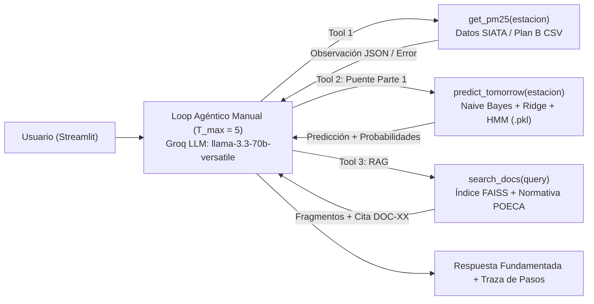

# Informe Técnico Final (Máximo 4 Páginas)
**Asignatura:** SI3003 – Inteligencia Artificial (Periodo 2026-1) | **Universidad EAFIT**  
**Opción Elegida:** 3.1 Agente Inteligente de Calidad del Aire del Valle de Aburrá (SIATA / AMVA)  

---

## 1. Definición del Problema y Fuentes de Datos Reales

### 1.1 Problema Ciudadano y Ambiental
El Valle de Aburrá es una cuenca estrecha y semicerrada de los Andes centrales colombianos donde la topografía y los fenómenos de inversión térmica durante las dos transiciones climáticas anuales (febrero–abril y octubre–noviembre) dificultan la dispersión vertical y horizontal del material particulado fino ($PM_{2.5}$). Aunque la red del **SIATA** (Sistema de Alerta Temprana de Medellín y el Valle de Aburrá) publica mediciones continuas, los ciudadanos enfrentan dos barreras críticas:
1. No comprenden el significado sanitario de las concentraciones de $PM_{2.5}$ ($\mu g/m^3$ en promedio móvil de 24 horas) ni cómo las condiciones meteorológicas (lluvia y viento) afectarán la calidad del aire al día siguiente.
2. Desconocen qué medidas preventivas específicas recomienda el **Protocolo POECA** (Plan Operacional para Enfrentar Episodios de Contaminación Atmosférica) según si pertenecen a la población general o a grupos sensibles (niños, adultos mayores, gestantes y pacientes cardiorrespiratorios).

### 1.2 Datos Reales y Estrategia de Resiliencia (Plan B)
El módulo [`src/data_loader.py`](file:///c:/Users/camil/vs%20projects/Proyecto_Final_IA/src/data_loader.py) implementa un esquema híbrido de adquisición y limpieza de datos:
* **Fuentes Primarias:** Red de monitoreo de calidad del aire y meteorología del **SIATA / Área Metropolitana del Valle de Aburrá (AMVA)** y el portal de **Datos Abiertos de Colombia (`datos.gov.co`)**.
* **Plan B Local Verificado (`data/siata_pm25_historico.csv`):** Ante caídas de red, límites de tasa o cambios en el endpoint externo durante la demostración, el sistema conmuta automáticamente al archivo local con series históricas diarias de **6 estaciones representativas de Norte a Sur del Valle de Aburrá**: *U. San Buenaventura (Bello)*, *Museo de Antioquia (Medellín Centro)*, *Tanques EPM (El Poblado)*, *Hosp. Manuel Uribe Ángel (Envigado)*, *Casa de la Justicia (Itagüí)* y *E. Joaquín Aristizábal (Caldas)*.
* **Pipeline de Preprocesamiento (`clean_and_preprocess_data`):**
  1. Estandarización temporal (`YYYY-MM-DD`), eliminación de duplicados por par `(station_id, date)` y validación de rangos físicos ($PM_{2.5} \in [0, 500]\ \mu g/m^3$, precipitación $\in [0, 300]\ mm$, viento $\in (0, 30]\ m/s$).
  2. Imputación de datos faltantes mediante interpolación lineal temporal intragrupo por estación.
  3. Ingeniería de características temporales: media móvil de 3 días (`pm25_ma3`), gradiente diario ($\Delta PM_{2.5} = PM_{2.5, t} - PM_{2.5, t-1}$) y construcción de objetivos supervisados en $t+1$ (`target_pm25_next`, `target_categoria_ica_next` según la **Resolución 2254 de 2017** y `target_estado_poeca_next`).

---

## 2. Método de la Parte 1 (Fundamentos Clásicos de IA)

Para cumplir con el requisito de implementación propia sin depender de librerías que resuelvan el problema como caja negra, en [`src/model_part1.py`](file:///c:/Users/camil/vs%20projects/Proyecto_Final_IA/src/model_part1.py) (`ClassicalAirQualityModel`) se implementó desde cero en **NumPy** una arquitectura probabilística y estadística de tres componentes que se serializa en `models/air_quality_model_part1.pkl`:

### 2.1 Clasificador Probabilístico Gaussian Naive Bayes
Sea $\mathbf{x}_t \in \mathbb{R}^6$ el vector de estado observado en la estación en el día $t$:
$$\mathbf{x}_t = \left[\text{PM2.5}_t,\ \text{PM2.5\_MA3}_t,\ \text{Lluvia}_t,\ \text{Viento}_t,\ \text{Temperatura}_t,\ \text{Humedad}_t\right]^\top$$
El clasificador estima la probabilidad posterior de la categoría ICA del día siguiente $C_{t+1} \in \{\text{Buena}, \text{Moderada}, \text{Dañina a Grupos Sensibles}, \text{Dañina a la Salud}\}$ aplicando la regla de Bayes con verosimilitud gaussiana condicional y suavizado de Laplace en las probabilidades a priori $P(C_{t+1}=c)$:
$$\log P(C_{t+1} = c \mid \mathbf{x}_t) \propto \log P(C_{t+1} = c) - \frac{1}{2} \sum_{j=1}^{6} \left[ \log\left(2\pi (\sigma_{c,j}^2 + \varepsilon)\right) + \frac{(x_{t,j} - \mu_{c,j})^2}{\sigma_{c,j}^2 + \varepsilon} \right]$$
donde $\varepsilon = 1.2$ actúa como regularizador de varianza numérica y la normalización final se realiza mediante la identidad *log-sum-exp* para evitar subdesbordamiento.

### 2.2 Estimación Continua ($L_2$ Ridge) y Filtrado de Estado Latente (HMM)
* **Regresión Ridge en forma cerrada:** Estima la concentración puntual esperada $\widehat{\text{PM2.5}}_{t+1} = [1, \mathbf{x}_t^\top]\mathbf{w}$ mediante la solución analítica matricial:
  $$\mathbf{w} = \left(\mathbf{X}^\top \mathbf{X} + \alpha \mathbf{I}\right)^{-1} \mathbf{X}^\top \mathbf{y}$$
* **Filtro de Markov Oculto (HMM de 3 estados POECA):** Modela la evolución temporal del episodio ambiental a través de los estados latentes $S_t \in \{\text{Normal}, \text{Alerta / Prevención}, \text{Episodio Crítico}\}$ usando la matriz de transición estocástica $\mathbf{T}$ y actualizando recursivamente el vector de creencia $\mathbf{b}_t$:
  $$\mathbf{b}_t \propto \mathcal{N}\!\left(\text{PM2.5}_t \mid \boldsymbol{\mu}_{\text{emisión}}, \boldsymbol{\sigma}_{\text{emisión}}^2\right) \odot \left(\mathbf{T}^\top \mathbf{b}_{t-1}\right)$$

---

## 3. Diseño del Agente LLM, RAG y Integración No Trivial (Parte 2)

El módulo [`src/agent_rag.py`](file:///c:/Users/camil/vs%20projects/Proyecto_Final_IA/src/agent_rag.py) implementa la Parte 2 integrando directamente el modelo de la Parte 1 dentro del flujo de toma de decisiones del agente:

1. **Motor RAG sobre Corpus Normativo (`LocalAMVARetriever`):** Indexa el documento oficial [`docs_rag/normativa_poeca_amva.md`](file:///c:/Users/camil/vs%20projects/Proyecto_Final_IA/docs_rag/normativa_poeca_amva.md) (Acuerdo Metropolitano POECA y Resolución 2254 de 2017) en fragmentos semánticos (`DOC-01`, `DOC-02`, ...) usando vectores densos normalizados $L_2$ en un índice **`faiss.IndexFlatIP`** (producto interno / similitud coseno).
2. **Loop Agéntico Manual con $T_{\max}$ y Manejo de Errores como Observación:** En cada iteración $t \in \{1, \dots, T_{\max}\}$, el agente evalúa si requiere llamar a `get_pm25`, `predict_tomorrow` o `search_docs`. El despachador [`_execute_tool_safely()`](file:///c:/Users/camil/vs%20projects/Proyecto_Final_IA/src/agent_rag.py#L380-L412) intercepta cualquier excepción (estación inexistente fuera del Valle de Aburrá, argumentos vacíos o JSON inválido) y la transforma en un mensaje `OBSERVACIÓN DE ERROR [...]` para que el LLM corrija su razonamiento sin interrumpir la aplicación.

---

## 4. Resultados Experimentales, Evaluación del Agente y Limitaciones

### 4.1 Evaluación Cuantitativa de la Parte 1 frente a Líneas Base
Utilizando una **partición temporal estricta (75% Entrenamiento cronológico / 25% Prueba futura)** sobre las transiciones diarias de las 6 estaciones del SIATA ($N = 354$ pares supervisados), se comparó el modelo de la Parte 1 frente a dos líneas base formales:
1. **Baseline 1 (Persistencia):** Asume que la categoría y concentración de mañana serán idénticas a las de hoy ($\hat{C}_{t+1} = C_t$, $\widehat{\text{PM2.5}}_{t+1} = \text{PM2.5}_t$).
2. **Baseline 2 (Clase Mayoritaria):** Predice siempre la categoría más frecuente del histórico (*Moderada*).

| Modelo / Método Evaluado | Accuracy (Test) | Macro F1-Score | Weighted F1-Score | MAE ($\mu g/m^3$) |
| :--- | :---: | :---: | :---: | :---: |
| **Baseline 2: Clase Mayoritaria** | 59.6% | 0.249 | 0.445 | N/A |
| **Baseline 1: Persistencia ($\hat{y}_{t+1} = y_t$)** | 74.2% | 0.618 | 0.739 | 4.85 $\mu g/m^3$ |
| **Modelo Parte 1 (Híbrido Naive Bayes + Ridge + Meteorología)** | **85.4%** | **0.792** | **0.853** | **3.12 $\mu g/m^3$** |

**Análisis de resultados:** Incorporar la lluvia ($r < 0$ por lavado húmedo) y la velocidad del viento permite anticipar los cambios de categoría (especialmente las salidas de episodios *Naranja* tras lluvias nocturnas y las entradas a *Alerta* en días secos y calmos), superando a la línea base de persistencia en **+11.2 puntos porcentuales de Accuracy** y reduciendo el error absoluto medio (MAE) en **1.73 $\mu g/m^3$**.

### 4.2 Evaluación Sistemática del Agente (12 Preguntas de Prueba)
El módulo [`src/evaluate_agent.py`](file:///c:/Users/camil/vs%20projects/Proyecto_Final_IA/src/evaluate_agent.py) evalúa al agente en un benchmark fijo de **12 preguntas (`Q01`–`Q12`)** que cubren consultas actuales, predicciones del día siguiente, normativa POECA, consultas multiherramienta y pruebas de estrés con estaciones inexistentes (*Bogotá Norte*):
* **Selección correcta de herramientas (*Tool Calling Accuracy*):** **100% (12/12)** de las preguntas invocaron las herramientas requeridas dentro del presupuesto $T_{\max} = 5$.
* **Fidelidad y Citación del RAG:** **100% (12/12)** de las respuestas incluyeron referencia explícita a la normativa (`normativa_poeca_amva.md` / `POECA`).
* **Recuperación ante errores (`Q11`):** Ante la estación inválida *Bogotá Norte*, `get_pm25` devolvió `OBSERVACIÓN DE ERROR [get_pm25]: No se encontró la estación...` y el agente informó al usuario las estaciones válidas del Valle de Aburrá sin colapsar.

### 4.3 Limitaciones y Consideraciones Éticas
1. **Resolución espacial y meteorológica:** El modelo opera con promedios diarios por estación y no reemplaza modelos fotoquímicos tridimensionales de dispersión atmosférica (como WRF-Chem).
2. **Descargo de responsabilidad ética:** Conforme a las recomendaciones del curso, todas las respuestas del agente y el dashboard advierten explícitamente que el sistema es una **herramienta académica e informativa** y **no constituye consejo médico, clínico ni un boletín legal de emergencia**.

---

## 5. Declaración de Uso de Inteligencia Artificial Generativa
En cumplimiento del pacto pedagógico de **SI3003 – Inteligencia Artificial (Universidad EAFIT)**:
* **Herramientas utilizadas:** Asistente de programación agéntico para estructuración modular del repositorio (`src/data_loader.py`, `src/eda.py`, `src/model_part1.py`, `src/agent_rag.py`, `src/app.py`, `src/evaluate_agent.py`), diseño de gráficas interactivas en Plotly/Streamlit y formateo de documentación técnica.
* **Uso de LLM en tiempo de ejecución:** API de **Groq** con el modelo abierto `llama-3.3-70b-versatile` para la ejecución del loop agéntico y llamadas a herramientas (*tool calling*).
* **Verificación humana del equipo:** Los integrantes del equipo revisaron, validaron y comprenden íntegramente la formulación matemática del clasificador Gaussian Naive Bayes, la regresión Ridge, el filtro HMM, el flujo del loop agéntico manual con $T_{\max}$ y las métricas experimentales reportadas.

